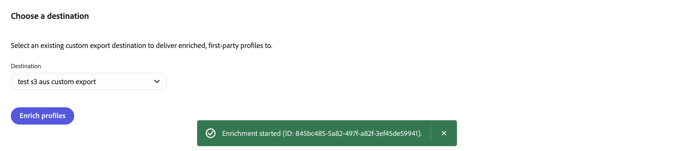

# The Trade Desk-Profilanreicherung (Alpha)

Verwenden Sie den Impression-Log-Daten-Feed des Raw-Ereignis-Datenstroms (REDS) von [!DNL The Trade Desk], um Anreicherungsattribute und Paid-Media-Kontext in Ihre Erstanbieterprofile zu exportieren.

Nachdem die CSV-Datei in Ihrem [!DNL Amazon S3] Exportziel eintrifft, nehmen Sie sie in [!DNL Adobe Real-Time CDP] auf. In dieser Version werden beim Exportieren der Datei nicht automatisch Profile aktualisiert oder Erlebnisse aktiviert. Die automatisierte Profilanreicherung in [!DNL Adobe Real-Time CDP] ist für eine nachfolgende Version geplant.

Durch Anzeigen wird Kontext zu Kundenprofilen hinzugefügt. Sie bestätigt nicht die Interaktion, Kaufabsicht oder langfristige Interessen.

## Vorbereiten der Anreicherung {#prepare-for-enrichment}

Bevor Sie beginnen, arbeiten Sie mit Ihrem Administrator-, Medien- und Daten-Team zusammen, um Folgendes sicherzustellen:

* Zugang zu [!DNL Adobe Real-Time CDP Collaboration] und eine unterzeichnete Teilnahmevereinbarung
* Ein mit [!DNL The Trade Desk] ausgefüllter Zugriffsbrief zur Autorisierung der Bereitstellung von REDS-Feeds.
* Erstanbieter-Zielgruppen in [!DNL Adobe Real-Time CDP Collaboration], die gehashte E-Mail-Adressen oder gehashte Telefonnummern verwenden. Andere Kennungen werden in dieser Version nicht unterstützt.
* Ein [!DNL Amazon S3] Ziel, das für den Empfang der Anreicherungsausgabe konfiguriert ist.
* Ein Prozess zum Aufnehmen der bereitgestellten Datei in [!DNL Adobe Real-Time CDP].

### Autorisieren des Quell-Feeds {#authorize-source-feed}

Um die Bereitstellung von REDS-Protokollen direkt an Adobe zu autorisieren, füllen Sie den von [!DNL The Trade Desk] bereitgestellten Zugriffsbrief aus.

[!DNL The Trade Desk] stellt den Quell-Feed bereit, und Adobe konfiguriert den Zugriff und die Aufnahme. Bevor Sie ein Projekt erstellen, überprüfen Sie, ob die Verbindung aktiv und der Feed bereit ist.

Nach der Verarbeitung gelangt die Ausgabedatei der Anreicherung zu Ihrem Exportziel.

### Vorbereiten der nachgelagerten Aufnahme {#prepare-downstream-ingestion}

Bitten Sie nach dem Versand Ihren [!DNL Adobe Real-Time CDP] oder das technische Supportteam, die Datei aufzunehmen.

## Verbinden und Erstellen von Projekten {#connect-create-projects}

Füllen Sie den Zugriffsbrief im Verbindungsdialogfeld aus und speichern Sie Ihre Partner-ID. Warten Sie, bis Adobe den Empfang Ihrer REDS-Protokolle bestätigt hat, bevor Sie ein Projekt erstellen. Beim Erstellen eines Projekts wird der Anreicherungsvorgang gestartet, für den sowohl Ihre Partner-ID als auch die Protokolle erforderlich sind.

### Verbinden mit dem Partner {#connect-partner}

Um eine Verbindung mit [!DNL The Trade Desk] herzustellen, öffnen Sie **[!UICONTROL Partner]**) in **[!UICONTROL Verbinden]** und suchen Sie nach dem Partner.

![Der Collaborator-Katalog listet [!DNL The Trade Desk] und die zugehörige [!UICONTROL Verbinden]-Option auf.](../../../assets/collaborate/advertising-platforms/discover-collaborators-trade-desk.png){zoomable="yes"}

Wählen Sie **[!UICONTROL Verbinden]** für die [!DNL The Trade Desk] aus und befolgen Sie die Anweisungen im Verbindungsdialogfeld.

![Im Verbindungsdialogfeld werden die REDS-Autorisierung und die Partner-ID-Einrichtung für [!DNL The Trade Desk] erläutert.](../../../assets/collaborate/advertising-platforms/trade-desk-connection-instructions.png){zoomable="yes"}

Nachdem die Verbindung aktiv ist, öffnen Sie **[!UICONTROL Verbindungseinstellungen]** und navigieren Sie zu **[!UICONTROL Advertiser-Informationen]**. Um vorhandene Informationen zu aktualisieren, wählen Sie **[!UICONTROL Bearbeiten]** aus. Um neue Informationen einzugeben, klicken Sie auf **[!UICONTROL Hinzufügen]**.

![Die aktiven Verbindungseinstellungen zeigen [!UICONTROL Advertiser-]) und das [!UICONTROL Bearbeiten]-Steuerelement.](../../../assets/collaborate/advertising-platforms/trade-desk-connection-settings.png){zoomable="yes"}

Um Ihre Advertiser-Informationen zu speichern, geben Sie die ID und den Partnernamen in **[!UICONTROL Partner-ID]** und **[!UICONTROL Partnernamen]** ein und klicken Sie dann auf **[!UICONTROL Speichern]**. Ihre Partner-ID wird unter **[!UICONTROL Sitzkennungen]** in Ihrem [!DNL The Trade Desk]-Konto angezeigt.

![Das Dialogfeld mit den Advertiser-Informationen enthält die erforderlichen Felder für die Partner-ID und den Partnernamen sowie ein [!UICONTROL Speichern]-Steuerelement.](../../../assets/collaborate/advertising-platforms/trade-desk-advertiser-partner-info-dialog.png){zoomable="yes"}

Warten Sie nach dem Speichern der Advertiser-Informationen, bis Adobe den Empfang Ihrer REDS-Protokolle bestätigt hat, bevor Sie ein Projekt erstellen.

### Erstellen eines Projekts {#create-project}

Um ein Projekt zu erstellen, gehen Sie zu **[!UICONTROL Zusammenarbeiten]** und wählen Sie **[!UICONTROL Meine Projekte]** und dann **[!UICONTROL Projekt erstellen]** oder das Symbol Hinzufügen () aus.

Wählen **[!UICONTROL in Projekt]** die Option [!DNL The Trade Desk] aus **[!UICONTROL Collaborator]**.

![Das Formular [!UICONTROL Projekt erstellen] listet [!DNL The Trade Desk] auf und enthält Felder für Projektname, Beschreibung und Bild.](../../../assets/collaborate/advertising-platforms/trade-desk-create-project.png){zoomable="yes"}

Geben Sie zur Identifizierung des Projekts einen **[!UICONTROL Projektnamen]** und **[!UICONTROL Beschreibung]** ein und wählen Sie dann ein Bild aus. Wenn die Projektdetails abgeschlossen sind, wählen Sie **[!UICONTROL Erstellen]** aus.

Informationen zum allgemeinen Projekt-Management finden Sie [ Handbuch zum Erstellen und Verwalten von Projekten ](/help/guide/collaborate/manage-projects.md).

## Auswählen und Exportieren von Attributen {#select-export-attributes}

Um Anreicherungsattribute für den Export auszuwählen, öffnen Sie das Projekt und wählen Sie **[!UICONTROL Anreichern]** aus. Um die Signalverfügbarkeit zu verstehen, überprüfen Sie die Abdeckungswerte für jedes Attribut, bevor Sie die Attribute auswählen, die Sie verwenden möchten.

![Die Seite [!UICONTROL Anreichern] gruppiert auswählbare Signale nach Kategorie und zeigt Abdeckungswerte an.](../../../assets/collaborate/advertising-platforms/enrich-attribute-selection.png){zoomable="yes"}

<!-- TODO: Replace the destination screenshot with one showing the [!UICONTROL Export Attributes] action. -->

Wählen Sie das [!DNL Amazon S3] Exportziel aus, das für die Anreicherungsausgabe konfiguriert ist. Wenn Sie ein Ziel konfigurieren müssen, finden Sie weitere Informationen unter [Konfigurieren und Verwalten von Cloud-Speicher-Zielen](/help/guide/destinations/manage-destinations.md).

<!-- ![The [!UICONTROL Choose a destination] screen lists a destination and the [!UICONTROL Export Attributes] action.](../../../assets/collaborate/advertising-platforms/enrich-choose-destination.png){zoomable="yes"} -->

Überprüfen Sie die ausgewählten Attribute und das Ziel und wählen Sie dann **[!UICONTROL Attribute exportieren]** aus.

<!-- {zoomable="yes"} -->

Beim Senden eines Exports wird der Versand gestartet, wenn Ihr Ziel richtig konfiguriert ist. Nachdem Sie den Export übermittelt haben, überprüfen Sie, ob die Dateibereitstellung außerhalb von [!DNL Adobe Real-Time CDP Collaboration] erfolgreich war.

Adobe verarbeitet Anreicherungsattribute, wenn Sie ein Projekt erstellen und dann wöchentlich. Bei jedem Durchlauf werden die letzten 90 Tage der verfügbaren [!DNL The Trade Desk] verwendet. Jeder Export enthält Ihre ausgewählten Attribute aus der zuletzt abgeschlossenen Ausführung. Um aktualisierte Attribute zu exportieren, fordern Sie nach Abschluss einer späteren Ausführung einen weiteren Export an.

### Verfügbare Anreicherungssignale {#available-signals}

Wählen Sie aus 18 kuratierten Signalen aus vier Kategorien. Benutzerdefinierte Anreicherungsausdrücke werden nicht unterstützt.

| Kategorie | Signal | Beschreibung |
| --- | --- | --- |
| Kern | [!UICONTROL Zuletzt offen gelegt am] | Das Datum, an dem eine Identität zuletzt einer Anzeige ausgesetzt wurde. |
| Kern | [!UICONTROL Belichtungszahl] | Eine Expositionsfrequenzkategorie anstelle einer Anzahl roher Impressionen. |
| Kern | [!UICONTROL Interessenten vs. Retargeting] | Eine abgeleitete Klassifizierung der Risikoposition als Prospektion oder Remarketing. |
| Kern | [!UICONTROL Produktkategorie angezeigt] | Eine abgeleitete Kategorie für die in den Anzeigen beworbenen Produkte. |
| Kern | [!UICONTROL Dominanter Inventarkanal] | Der Hauptinventarkanal, der mit der Anzeigenexposition verbunden ist. |
| Kern | [!UICONTROL Dominanter Gerätetyp] | Der Hauptgerätetyp, der mit der Anzeigenbelichtung verbunden ist. |
| Geografie | [!UICONTROL Stadt] | Stadtinformationen, die aus dem Werbekontext abgeleitet wurden, kein verifizierter Standort. |
| Geografie | [!UICONTROL Region/Bundesland] | Regions- oder Statusinformationen aus dem Werbekontext. |
| Geografie | [!UICONTROL DMA] | Aus dem Werbekontext abgeleitete Informationen zum designierten Marktgebiet (DMA). |
| Verbundenes Fernsehen (CTV) | [!UICONTROL CTV belichtet] | Belichtung auf einem angeschlossenen Fernsehgerät. |
| Verbundenes Fernsehen (CTV) | [!UICONTROL Live-Stream-Viewer] | Anzeigen-Exposition im Live-Stream-Inventar, kein Nachweis der Anzeige oder Interaktion. |
| Verbundenes Fernsehen (CTV) | [!UICONTROL PMP/Premium-Exposition] | Risikopositionen gegenüber dem privaten Marktplatz (PMP) oder dem privaten Kontrakt, nicht von unabhängiger Seite geprüfter Prämienbestand. |
| Affinität des Inhalts | [!UICONTROL Connected TV/Streaming] | Anzeigen-Offenlegung in Verbindung mit Streaming-Inhalten. |
| Affinität des Inhalts | [!UICONTROL Gamer] | Anzeigen-Offenlegung in Verbindung mit Gaming-Inhalten, Sites oder Apps. |
| Affinität des Inhalts | [!UICONTROL Sportfan] | Anzeigen-Exposition in Verbindung mit Sportinhalten, Sites oder Apps. |
| Affinität des Inhalts | [!UICONTROL Nachrichten-Follower] | Anzeigen-Exposition in Verbindung mit Nachrichteninhalten, Sites oder Apps. |
| Affinität des Inhalts | [!UICONTROL Musikliebhaber] | Belichtung von Anzeigen, die mit Musikinhalten, Sites oder Apps verknüpft sind. |
| Affinität des Inhalts | [!UICONTROL Inhaltsgenre] | Das Inhalts-Genre, das mit der Anzeigenveröffentlichung verknüpft ist. |

Geografische Signale beschreiben eher den Werbekontext als ein verifiziertes Zuhause oder einen aktuellen Standort. Inhaltsaffinitätssignale bestätigen keine persönlichen Interessen oder Vorlieben. Einige Attribute enthalten möglicherweise keine Werte, wenn keine Quellinformationen verfügbar sind.

### Attributabdeckung {#attribute-coverage}

Die Abdeckung beschreibt, wie oft verarbeitete Datensätze einen Attributwert enthalten. Bei Ja/Nein-Signalen, wie **[!UICONTROL CTV belichtet]** zählt die Abdeckung Datensätze mit einem echten Wert. Die Abdeckung gibt keine Übereinstimmungsraten für Identitäten oder den Anteil der Erstanbieterprofile an, die ein Attribut erhalten.

Identitätsabgleich, Verfügbarkeit von Quellsignalen und Aufnahme wirken sich auf Profilaktualisierungen aus. Die Abdeckung bestätigt nicht den Abschluss des Exports oder die Profilaktualisierungen.

### Workflow-Umfang {#workflow-scope}

Um Daten aus [!DNL The Trade Desk] anzureichern, verwenden Sie den kuratierten Katalog. Sie können keine Rohprotokolle exportieren oder benutzerdefinierte Attributausdrücke erstellen. Andere Integrationen mit Demand-Side-Platform (DSP) und Supply-Side-Platform (SSP) werden nicht unterstützt.

Dieser Workflow unterstützt nicht die Erkennung von Anreicherungsmöglichkeiten, die Analyse von Zielgruppenüberschneidungen oder die Attribution und die Messung der Inkrementalität.

## Aufnehmen und Validieren von Ergebnissen {#ingest-validate-results}

Bitten Sie nach dem Versand Ihren [!DNL Adobe Real-Time CDP] oder das technische Supportteam, die Datei aufzunehmen.

### Ausgabedatei {#output-file}

Der Export stellt eine CSV-Datei an Ihr konfiguriertes [!DNL Amazon S3]-Ziel bereit.

<!-- 
TODO: replace this placeholder with the engineering-confirmed output specification:
* Required hashing and normalization for each identifier, including whether email requires SHA-256 after trimming and lowercasing.
* Exact CSV headers, the file naming pattern, and the delivery bucket and path.
* Each identifier column in the delivered file and the identity namespace to map that column to during ingestion.
Do not treat example formats or supported input match keys as confirmed output requirements.
-->

Überprüfen Sie den Export getrennt von den Profilaktualisierungen:

1. Vergewissern Sie sich, dass die CSV-Datei am vorgesehenen [!DNL Amazon S3] angekommen ist.
1. Überprüfen Sie, ob die Datei die erwarteten Kennungen und ausgewählten Attribute enthält.
1. Nehmen Sie die Datei mithilfe der bestätigten Identitäts- und Schemazuordnungen für die Ziel-Sandbox und den Datensatz auf.
1. Überprüfen Sie die Aufnahmeergebnisse und stellen Sie sicher, dass ein Beispiel für erwartete Profile die Anreicherungsattribute enthält.

Der Export einer Datei bestätigt nicht, dass die Aufnahme die Profile aktualisiert hat. Um Profile zu aktualisieren, nehmen Sie jeden späteren Export separat auf.

## Fehlerbehebung bei der Anreicherung {#troubleshoot-enrichment}

Verwenden Sie die folgenden Prüfungen, um Probleme mit Quelldaten, Export und Aufnahme zu beheben:

| Problem | Was zu überprüfen ist |
| --- | --- |
| Die Verbindung oder **[!UICONTROL Anreichern]** ist nicht verfügbar | Bitten Sie Ihren Administrator, Ihre Verbindung und Ihren Projektzugriff zu bestätigen. Bestätigen Sie, dass die Einrichtung des Quell-Feeds abgeschlossen ist. |
| Kein Exportziel verfügbar | Bitten Sie Ihren Administrator, zu bestätigen, dass ein Ziel konfiguriert und für die Anreicherungsausgabe verfügbar ist. |
| Ein Attribut hat eine begrenzte Abdeckung | Überprüfen Sie die Verfügbarkeit von Quelldaten mit Ihrem Medien-Team. Abdeckung nicht als Übereinstimmungsrate der Profile interpretieren. |
| Ein Export wurde angefordert, aber es ist keine Datei vorhanden | Überprüfen Sie das beabsichtigte Ziel mit Ihrem Daten-Team. Die Anfrageübermittlung bestätigt den Versand nicht. |
| Eine bereitgestellte Datei enthält keine aktualisierten Profile | Überprüfen Sie die Aufnahmeergebnisse und bestätigen Sie die Identitäts- und Schemazuordnungen. Export und Aufnahme sind separate Vorgänge. |
| Es kann kein Export angefordert werden | Wählen Sie mindestens ein Attribut und ein Ziel aus. Wenn ein Export bereits verarbeitet wird, warten Sie, bis er abgeschlossen ist, bevor Sie einen weiteren anfordern. |
| Die Abdeckung ist hoch, aber nur wenige Profile erhalten Attribute | Abdeckung ist keine Übereinstimmungsrate für Identitäten. Vergewissern Sie sich, dass der Quell-Feed bereit ist, die Zielgruppe unterstützte Übereinstimmungsschlüssel verwendet und Ihre Identitätszuordnung während der Aufnahme korrekt ist. |
| Nach dem Erstellen eines Projekts werden keine Attribute oder Abdeckungen angezeigt | Die Projekteinrichtung ist beim Erstellen fest. Wenn Adobe Ihre REDS-Protokolle zu diesem Zeitpunkt noch nicht von [!DNL The Trade Desk] erhalten hat, kann das Projekt sie später nicht mehr verwenden. Nachdem Adobe den Empfang Ihrer Protokolle bestätigt hat, erstellen Sie ein neues Projekt. |
| Profile haben die Attribute, aber eine Zielgruppe oder ein Erlebnis spiegelt sie nicht wider | Überprüfen Sie Zielgruppenevaluierung, Identität, Einverständnis und nachgelagerte Regeln für Erlebnis-Targeting. |

## Nächste Schritte {#next-steps}

Erstellen Sie nach der Aufnahme und Validierung der Attribute Zielgruppen in [!DNL Adobe Real-Time CDP], indem Sie Anreicherungssignale mit First-Party-Daten kombinieren. Weitere Informationen finden Sie im &quot;[ Builder-Handbuch](https://experienceleague.adobe.com/en/docs/experience-platform/segmentation/ui/audience-builder){target="_blank"}.

Informationen zum Aktivieren von Zielgruppen für Ziele, Personalisierung oder Kunden-Journey finden Sie im [Handbuch zur Zielgruppenaktivierung](https://experienceleague.adobe.com/en/docs/experience-platform/destinations/ui/activate/activation-overview){target="_blank"}.
