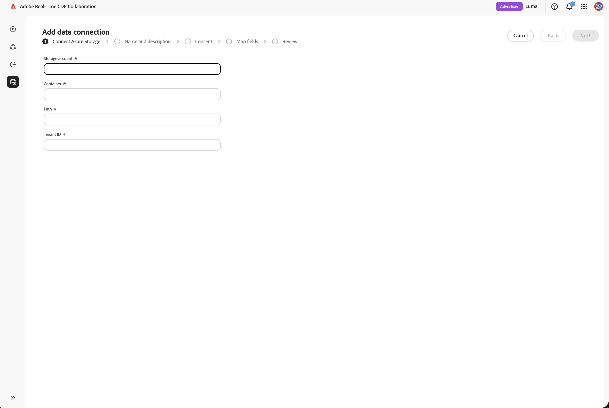

# Konfigurieren [!DNL Azure] Datenspeichers für die Beschaffung von Werbeeinblendungen

Verbinden Sie Ihr [!DNL Azure Data Lake Storage]- oder [!DNL Azure Blob Storage]-Konto mit Adobe Real-Time CDP Collaboration, um Daten zur Werbegefährdung (Ad-Log) für die Messung zu erhalten.

Das Messmodul in Real-Time CDP Collaboration verbindet Advertiser-Konversionsdaten mit Publisher-Anzeigenexpositionsprotokollen, um datenschutzorientierte Kampagnenberichte bereitzustellen. Dadurch wird ein Self-Service-Pfad ohne Code für Werbetreibende und Herausgeber hinzugefügt. Sie können die Anzeigen-Exposure(Impression)-Protokolle, die Sie bereits in [!DNL Azure] aufbewahren, zur Attribution in die Messung einbeziehen, ohne von Adobe Experience Platform abhängig zu sein. Sie verbinden ein Speicherkonto, einen Container und einen Pfad, bestätigen, dass die erkannten Daten mit den Erwartungen des Anzeigenprotokoll-Schemas übereinstimmen, und beenden die Messung in Minuten.

Daten werden nicht zum Zeitpunkt der Verbindung abgerufen. Die Beschaffung wird ausgelöst, wenn Sie einen Messbericht ausführen. Um die Speicherkapazität zu minimieren, löscht Adobe nach einer 7-tägigen Aufbewahrungsfrist automatisch Quellwerbeprotokolle.

Die Governance- und Datenbehandlungsregeln für Anzeigenprotokolle, die von [!DNL Azure] bezogen werden, stimmen mit den Regeln überein, die für Daten gelten, die von Adobe Experience Platform bezogen werden.

>[!NOTE]
>
>In diesem Handbuch wird beschrieben, wie Advertiser und Publisher **Anzeigenprotokolle** (Werbeexponierungen) aus dem Cloud-Speicher bezogen werden. Die Beschaffung von Konversionsdaten aus dem Cloud-Speicher ist in Kürze verfügbar.

## Voraussetzungen {#prerequisites}

Füllen Sie alle Elemente in diesem Abschnitt aus, bevor Sie den Konfigurations-Workflow starten. Bevor Sie dieses Handbuch befolgen, müssen Sie das [Onboarding und Einrichten von Konten“ &#x200B;](./onboard-account.md) haben.

### [!DNL Azure] und Berechtigungen {#azure-access-and-permissions}

Sie oder Ihr [!DNL Azure]-Administrator müssen in der Lage sein, die Rolle **[!DNL Storage Blob Data Reader]** während des Schritts **[!UICONTROL Einverständnis]** des Assistenten Ihrem Speicherkonto zuzuweisen. Siehe [Verbinden von Anzeigenprotokollen im Assistenten](#connect-adlogs).

### Vorbereiten der Anzeigenprotokolldaten {#prepare-adlog-data}

Ihre Ad-Log-Dateien müssen dem [Ad-Log-Schema](#ad-log-schema) entsprechen, bevor die Beschaffung beginnt. Zu den wichtigsten Anforderungen gehören:

* **Dateiformat: Nur** CSV.
* **Kanonische Spaltenüberschriften:** Dateien müssen die kanonischen Spaltenüberschriften verwenden, die im [Anzeigenprotokollschema“ definiert &#x200B;](#ad-log-schema). Diese Version unterstützt keine Neuzuordnung pro Spalte oder automatisierte Schemazuordnung.
* **Erforderliche Felder** Alle erforderlichen Felder müssen zusammen mit mindestens einem Übereinstimmungsschlüssel vorhanden sein.
* **Hashing der Übereinstimmungsschlüssel:** Hashwerte für Übereinstimmungsschlüssel müssen im Hexadezimalsystem SHA-256 in Kleinbuchstaben angegeben werden.
* **Spaltenkonsistenz:** Jede Datei in Ihrem konfigurierten Pfad muss ein identisches Spalten-Layout aufweisen.
* **Unterordner:** Dateien müssen sich direkt am angegebenen Pfad befinden. Collaboration durchläuft keine Unterordner.

## Verbinden von Anzeigenprotokollen im Assistenten {#connect-adlogs}

Gehen Sie wie folgt vor, um Ihre [!DNL Azure] Ad-Protokolle über Collaboration zu verbinden.

1. Wählen Sie im **[!UICONTROL Setup]**-Arbeitsbereich **[!UICONTROL Meine Messdaten]**, klicken Sie dann auf das Symbol Hinzufügen und wählen Sie **[!UICONTROL Messdaten]**.

   {zoomable="yes"}

2. Wählen **[!UICONTROL Workflow „Messdaten hinzufügen]** **[!UICONTROL Advertising-Belichtungen]** als Messdatentyp aus und klicken Sie dann auf **[!UICONTROL Weiter]**.

   {zoomable="yes"}

3. Um Ihre Messdaten zu importieren, klicken Sie auf **[!UICONTROL Neue Datenverbindung hinzufügen]** und dann auf **[!UICONTROL Weiter]**.

   {zoomable="yes"}

4. Wählen Sie die Datenquelle für Ihre neue Datenverbindung aus: **[!UICONTROL Azure Blob Storage]** oder **[!UICONTROL Azure Data Lake Storage Gen 2]**. Klicken Sie auf **[!UICONTROL Weiter]**.

   {zoomable="yes"}

5. Der **[!UICONTROL „Datenverbindung hinzufügen]** wird geöffnet. Geben Sie im Schritt **[!UICONTROL Azure-]** verbinden **[!UICONTROL die Speicherkonto]**, **[!UICONTROL Container]**, **[!UICONTROL Pfad]** und **[!UICONTROL Mandanten-ID]** an, wo Ihre Ad-Protokolldateien vorhanden sind. Alle Felder sind erforderlich und alle Dateien im konfigurierten Pfad werden als ein Datensatz behandelt.

   {zoomable="yes"}

6. Geben **[!UICONTROL im Schritt „Name und]**&quot; einen **[!UICONTROL Datenverbindungsnamen“ (]**) und eine optionale **[!UICONTROL Beschreibung]** für die Datenverbindung an.

   {zoomable="yes"}

7. Wählen Sie **[!UICONTROL Schritt]** Einverständnis“ das Startsymbol neben der **[!UICONTROL Einverständnis-URL]**, um die [!DNL Azure] zu öffnen und Zugriff auf die aufgelistete Anwendung zu gewähren. Weisen Sie dieser Anwendung in Ihrem Speicherkonto die Rolle **[!DNL Storage Blob Data Reader]** zu, kehren Sie dann zu Collaboration zurück und klicken Sie auf **[!UICONTROL Weiter]**, um den Zugriff zu überprüfen.

   >[!NOTE]
   >
   >Es kann einige Minuten dauern, bis die Funktionszuweisung propagiert wird. Wenn die Verifizierung fehlschlägt, warten Sie einen Moment und klicken Sie erneut **[!UICONTROL Weiter]**.

   {zoomable="yes"}

8. Im Schritt **[!UICONTROL Felder zuordnen]** sollten Sie die erkannten Spalten in der Vorschau anzeigen, um zu bestätigen, dass der Assistent die richtigen Dateien liest, und dann das [Ad-Log-Schema](#ad-log-schema) überprüfen, in dem alle von der Messung erfassten Felder aufgeführt sind, welche Felder erforderlich oder optional sind und welche erkannten Spalten als Identitäts-/Übereinstimmungsschlüssel erkannt werden. Dieser Schritt ist eine schreibgeschützte Validierung: Das System bestätigt, dass die erforderlichen Kopfzeilen vorhanden sind, und blockiert Sie, wenn ein erforderliches Feld fehlt. In dieser Version gibt es keine Neuzuordnung pro Spalte.

   {zoomable="yes"}

9. Gehen Sie **[!UICONTROL Schritt]**&#x200B;Überprüfen“ wie folgt vor: „Überprüfen und beenden“. Die Verbindung wird im Bereich Messdaten mit ihrem Status angezeigt, der **ausstehend** bis der erste Messbericht Quelldaten ausführt.

## Funktionsweise der Ad-Log-Beschaffung {#how-it-works}

Die Beschaffung von Anzeigen-Protokollen aus [!DNL Azure] spiegelt den allgemeinen Fluss wider, der für die Zielgruppen-Beschaffung verwendet wird:

1. **Cloud-Speicherverbindung:** Konfigurieren Sie den schreibgeschützten Zugriff auf ein Speicherkonto oder einen Container, in dem Ihre Anzeigenprotokolle gespeichert sind.
2. **Schemaprüfung und -validierung:** System validiert Ihre Dateien anhand des Ad-Log-Schemas (Ordner-, Datei- und erforderlichen Header-Prüfungen; schreibgeschützt).
3. **Feldzuordnung:** Quellidentitätsfelder werden automatisch auf der Grundlage der kanonischen Spaltennamen kanonischen Feldern zugeordnet. Es gibt keine manuelle Neuzuordnung.
4. **Aufnahme und Normalisierung:** Ereignisse werden auf eine Zeile pro Exposition normalisiert. Die Protokollbeschaffung beginnt, wenn Sie einen Messbericht ausführen.

### Anzeigenprotokollschema (kanonisches CSV-Format) {#ad-log-schema}

Erforderliche Felder müssen vorhanden sein, und mindestens ein Feld mit der Markierung **Join-Schlüssel (eins von erforderlich)** in der folgenden Tabelle muss ebenfalls vorhanden sein. Die Übereinstimmungs-Schlüssel-Hash-Werte sind hexadezimale SHA-256-Kleinbuchstaben.

| Feld | Datentyp | Erforderlich | Beschreibung |
| --- | --- | --- | --- |
| `EVENT_DATETIME` | Zeichenfolge (ISO 8601) | Erforderlich | Zeitstempel des Ereignisses |
| `EVENT_ID` | Zeichenfolge | Optional | Eindeutige ID für das Ereignis |
| `EVENT_TYPE` | Zeichenfolge (enum) | Erforderlich | Ereignistyp. Eines von `{impression, click}` |
| `HASHED_EMAIL_SHA_256` | Zeichenfolge (hexadezimaler Wert für 64 Zeichen) | Join-Schlüssel (einmalig erforderlich) | Kleinbuchstaben hex SHA-256 der E-Mail |
| `HASHED_IPV4_SHA_256` | Zeichenfolge (hexadezimaler Wert für 64 Zeichen) | Join-Schlüssel (einmalig erforderlich) | Kleinbuchstaben hex SHA-256 von IPv4 |
| `DEVICE_ID` | Zeichenfolge (hexadezimaler Wert für 64 Zeichen) | Join-Schlüssel (einmalig erforderlich) | Gerätewerbe-ID |
| `DEVICE_ID_TYPE` | Zeichenfolge (enum) | Optional | Eines von `{idfa, gaid, aaid, rida, afai, msai, vida, lgudid, tifa}` |
| `ECID` | Zeichenfolge (hexadezimaler Wert für 64 Zeichen) | Join-Schlüssel (einmalig erforderlich) | Demdex-basierte ECID |
| `CUSTOM_ID` | Zeichenfolge | Optional | Beständige ID des Herausgebers/Partners (z. B. PPID, RampID, Core ID) |
| `ADVERTISER_ID` | Zeichenfolge | Erforderlich | Eindeutige Kennung für den Advertiser |
| `ADVERTISER_NAME` | Zeichenfolge | Optional | Werbekunden-/Markenname |
| `CAMPAIGN_ID` | Zeichenfolge | Erforderlich | Plattformspezifische Kampagnenkennung |
| `CAMPAIGN_NAME` | Zeichenfolge | Optional | Von Menschen lesbarer Kampagnenname |
| `PLACEMENT_ID` | Zeichenfolge | Erforderlich | Eindeutige Kennung der Platzierung |
| `PLACEMENT_NAME` | Zeichenfolge | Optional | Beschreibender Platzierungsname |
| `CREATIVE_ID` | Zeichenfolge | Optional | Eindeutige Kennung für die kreative Anzeige |
| `CREATIVE_NAME` | Zeichenfolge | Optional | Von Menschen lesbarer kreativer Name |
| `AUDIENCE_ID` | Zeichenfolge | Optional | Zielgruppensegmentkennung |
| `AUDIENCE_NAME` | Zeichenfolge | Optional | Von Menschen lesbarer Zielgruppenname |
| `DEVICE_TYPE` | Zeichenfolge (enum) | Optional | Eines von `{mobile, desktop, tablet, ctv, dooh, car, in_store, other}` |
| `AD_FORMAT` | Zeichenfolge (enum) | Optional | Eines von `{display, video, native, audio, search, commerce, dooh, other}` |
| `SITE_NAME` | Zeichenfolge | Optional | Netzwerk-/Site-/App-/Publisher-Eigenschaft, in der die Impression aufgetreten ist |
| `TEST_GROUP` | Zeichenfolge | Optional | Gruppierung für Auftriebsstudien, Test-/Kontrollgruppen, Holdout-Gruppen |
| `CUSTOM_DIM` | Zeichenfolge | Optional | Zusätzliche Publisher-Dimension |

{style="table-layout:auto"}

>[!NOTE]
>
>`MATCH_KEY_TYPE` ist als optionales Feld im Schema enthalten, sodass im Laufe der Zeit mehrere ID-Typen parallel unterstützt werden können und die Herkunft von Übereinstimmungsschlüsseln (E-Mail, Telefon oder CRM) beibehalten werden kann, ohne den Vertrag der Version 1 zu brechen.

### Validierungsanforderungen (v1) {#validation-requirements}

Das System validiert und protokolliert Quelldaten, bevor Sie den Einrichtungs-Workflow abschließen. Validierungsprüfungen:

* Der Quellordner muss mindestens eine Datei enthalten.
* Dateien dürfen nicht leer sein.
* Erforderliche Schemakopfzeilen müssen vorhanden sein.
* Optionale Schemafelder können weggelassen werden.
* Dateien, die nur die erforderlichen Felder enthalten, sind gültig.

Validierungsfehler verhindern, dass Sie fortfahren. Das System überprüft **nicht** Datentypen, Feldwerte, die Vollständigkeit von Datensätzen, die Datenqualität oder die automatisierte Schemazuordnung. Die Validierung ist auf Ordner-, Datei- und erforderliche Kopfzeilenprüfungen für diese erste Version beschränkt.

## Bekannte Einschränkungen {#known-limitations}

Beachten Sie die folgenden Einschränkungen bei der Konfiguration und Verwendung [!DNL Azure] Beschaffung von Anzeigenprotokollen:

* **Nur Anzeigenprotokolle:** Diese Verbindung führt zu Advertiser- oder Publisher-Anzeigenprotokollen (Werbegefährdungen). Konvertierungsdaten werden noch nicht unterstützt.
* **Unterstützte Quellen:** [!DNL Azure Data Lake Storage] oder [!DNL Azure Blob Storage] und [!DNL Google Cloud Storage].
* **Dateiformat: Nur** CSV.
* **Kanonische Kopfzeilen erforderlich:** Es gibt keine Neuzuordnung pro Spalte und keine intelligente/automatisierte Zuordnung. Ihre Dateien müssen die kanonischen Spaltennamen verwenden.
* **Keine Wert-/Typvalidierung** Nur erforderliche Spaltenüberschriften werden validiert. Anfangs sind möglicherweise keine Datenzeilen vorhanden.
* **Nach der Erstellung kann eine Verbindung nicht bearbeitet werden** Jede Änderung, einschließlich der Änderung der aktiven Übereinstimmungsschlüssel, erfordert die Erstellung einer neuen Verbindung.
* **Ein Layout pro Pfad:** Alle Dateien im Pfad müssen dasselbe Spalten-Layout haben. Gemischte Layouts können zu partiellen Sourcing-Fehlern führen.
* **Nicht durchlaufene Unterordner** Dateien müssen sich direkt im angegebenen Pfad befinden.
* **Kein Zeitplan oder Rückblick bei der Einrichtung:** Die Beschaffung von Anzeigenprotokollen beginnt, wenn Sie einen Messbericht ausführen. Festlegen des Lookback-Zeitraums bei der Konfiguration des Berichts.
* **Eine Ad-Log-Datenverbindung:** Konfigurieren Sie jeweils nur eine Ad-Log-Datenverbindung. Messberichte verwenden automatisch die konfigurierte Verbindung.

## Fehlerbehebung {#troubleshooting}

* **Verbindung zeigt ausstehende/keine Daten:** Dies wird bis zur Ausführung des ersten Messberichts erwartet. Zur Verbindungszeit werden keine Daten abgerufen.
* **Keine Daten gefunden“ im Quellschritt:** Ordner ist leer. Fügen Sie Dateien hinzu, bevor Sie fortfahren.
* **Vorschau zeigt keine Spalten an:** Die Datei ist vorhanden, aber leer (keine Kopfzeilen oder Inhalte).
* **Übergabe der Validierung kann nicht abgerufen werden** Eine erforderliche Spaltenüberschrift fehlt. Bestätigen Sie anhand kanonischer Namen, dass die erforderlichen Felder und mindestens ein Übereinstimmungsschlüssel vorhanden sind.
* **Nicht erkannte Spalten** Nicht-kanonische Spaltennamen werden nicht als bekannte Felder übernommen. Benennen Sie sie in das kanonische Format um. In dieser Version gibt es keine Neuzuordnung.
* **Die Beschaffung schlägt nach der Einrichtung fehl:** Vergewissern Sie sich, dass sich der Lesezugriff von Adobe auf das Speicherkonto oder den Container nicht geändert hat und dass im konfigurierten Pfad noch Dateien im kanonischen Format vorhanden sind.
* **Datumsbereich des Berichts nicht vollständig abgedeckt:** Sie sich an den automatischen Ablauf von 7 Tagen. Protokolle, die älter als 7 Tage sind, sind für den angeforderten Bereich möglicherweise nicht verfügbar.

## Überlegungen zur Aktualisierung oder Migration {#upgrade-migration}

* Kunden, die zuvor über Experience Platform oder die von Adobe unterstützte Einrichtung integriert wurden, können zum Self-Service-Cloud-Speicherpfad wechseln. Bestehende Messberichte und -flüsse bleiben unverändert.
* Übereinstimmungsschlüssel, die in Ad-Protokolldateien vorhanden sind, müssen für das Collaboration-Konto aktiviert werden, wie bei der Zielgruppen-Beschaffung.
* Die Governance- und Datenverarbeitungsregeln stimmen mit den aus Experience Platform stammenden Daten überein.

## Nächste Schritte {#next-steps}

Nach Abschluss der Beschaffung stehen Ihre Anzeigenprotokolle für das Reporting zur Messung zur Verfügung.

Informationen zu anderen Beschaffungsmethoden für Werbeeinblendungen finden Sie unter [Konfigurieren von Google Cloud Storage für die Beschaffung von Werbeinformationen](./configure-gcs-adlog-sourcing.md).
