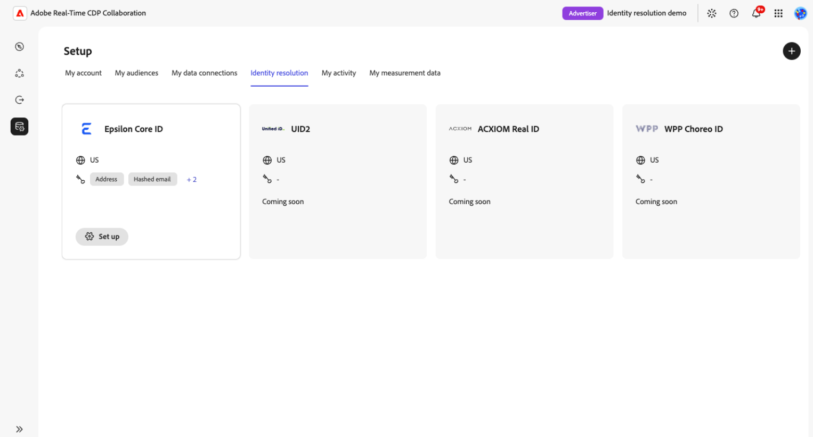
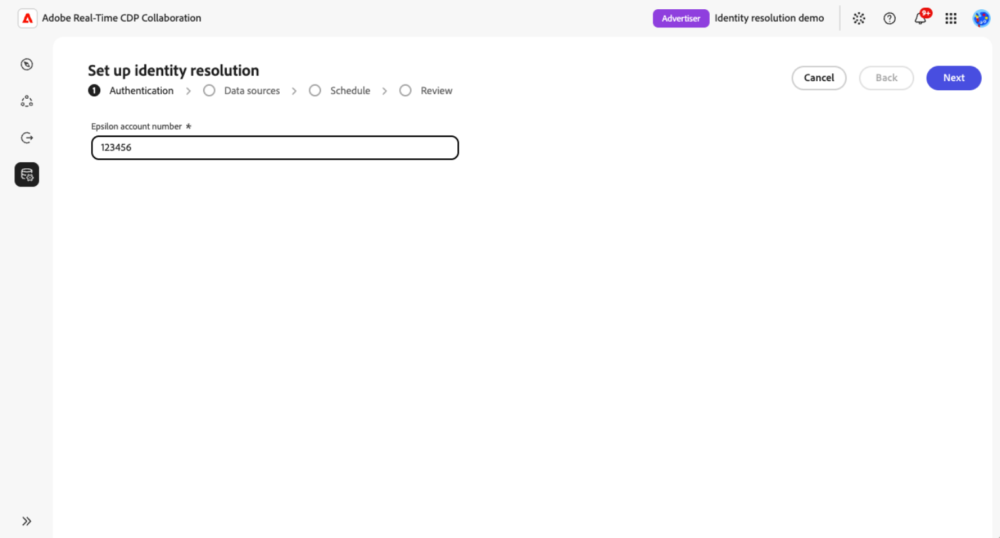
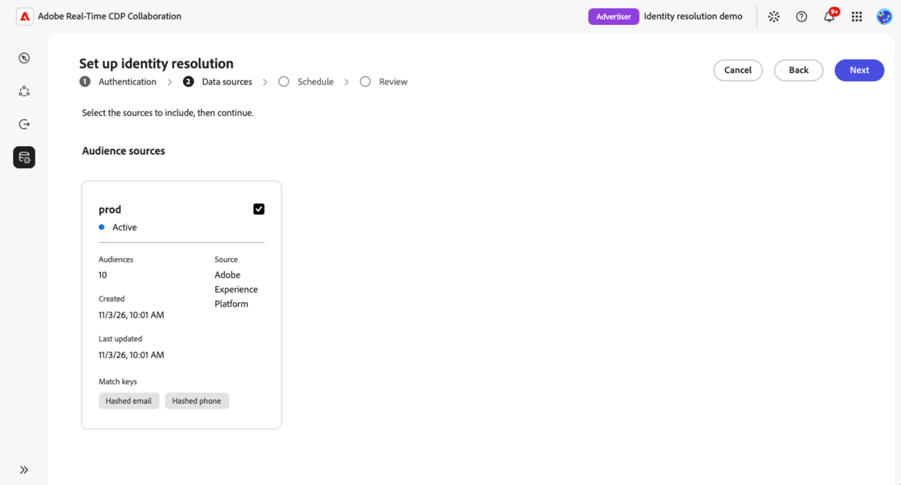
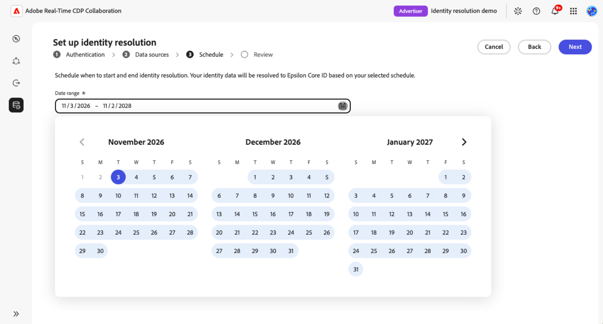
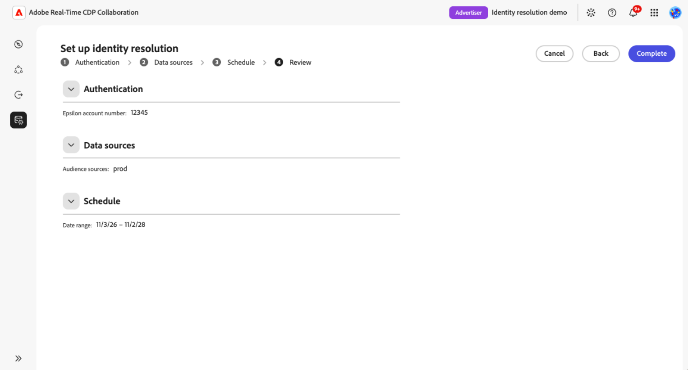
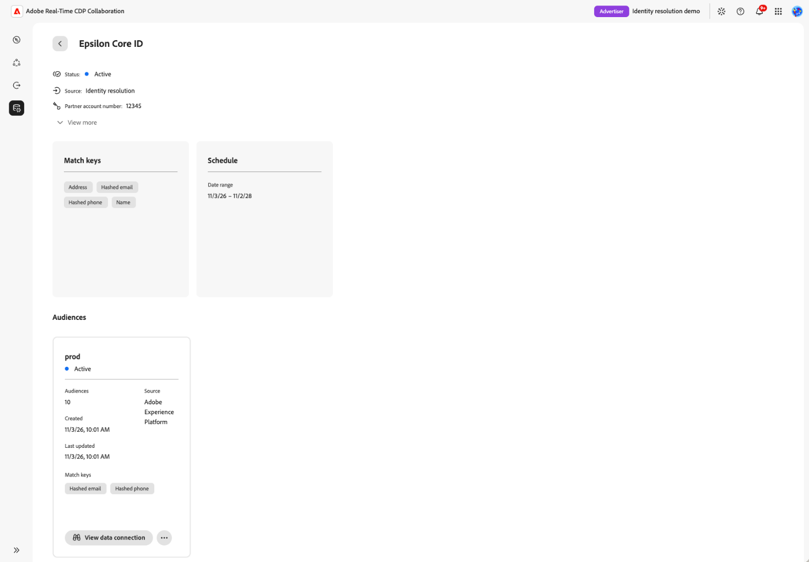

# Einrichten und Verwalten der Identitätsauflösung

{{limited-availability-release-note}}

Mit der Identitätsauflösung können Sie Kundinnen und Kunden identifizieren, die mit Mitarbeitern gemeinsam haben, auch wenn Ihre Organisationen unterschiedliche Kennungen verwenden. Konfigurieren und verwalten Sie die Identitätsauflösung mit unterstützten Identitätsanbietern in Real-Time CDP Collaboration, ohne benutzerdefinierte Integrationen für jeden Partner zu erstellen.

>[!NOTE]
>
>Derzeit ist nur die Epsilon Core ID zur Konfiguration verfügbar und nur für Real-Time CDP Collaboration-Konten, die in den Vereinigten Staaten bereitgestellt werden. Die Schritte und Screenshots in diesem Handbuch verwenden die Epsilon Core ID.

## Voraussetzungen {#prerequisites}

Bevor Sie beginnen, stellen Sie Folgendes sicher:

* **Berechtigungen zur Kontoverwaltung.** Sie müssen über **[!UICONTROL Konto verwalten]** und **[!UICONTROL Collaboration-Instanzen verwalten]** verfügen.
* **Mindestens eine Zielgruppen-Datenverbindung.** Sie benötigen eine vorhandene Zielgruppendaten-Verbindung, um die Identitätsauflösung zu konfigurieren. [Bei Bedarf Zielgruppen-](./source-overview.md) einrichten. Messdatenverbindungen werden nicht unterstützt.
* **Unterstützte Übereinstimmungsschlüssel und -felder.** Jede Zielgruppendaten-Verbindung, die Sie für die Identitätsauflösung verwenden möchten, muss Felder enthalten, die von Ihrem Identitätsanbieter unterstützt werden. Für die Epsilon Core ID können Sie gehashte E-Mails, gehashte Telefonnummern oder Namen in Kombination mit einer Postanschrift verwenden.

  Übereinstimmungsschlüssel auf Kontoebene, wie z. B. Hash-E-Mails und Hash-Telefonnummern, müssen für Ihr Konto aktiviert und Ihren Zielgruppendaten zugeordnet werden. Die Felder Name und Postanschrift werden während der Einrichtung der Zielgruppendaten-Verbindung zugeordnet und erfordern keine Aktivierung auf Kontoebene.

  Bei Verwendung von Name und Postanschrift müssen Sie mindestens ein Feld aus jeder Gruppe zuordnen:

  * **Name:** Vorname, Nachname oder Vollständiger Name.
  * **Postanschrift:** Straße, Stadt, Postleitzahl, Bundesland oder Land.

  Die Werte für Name und Anschrift werden nicht gehasht. Anweisungen zum Aktivieren von Übereinstimmungsschlüsseln auf Kontoebene, wie z. B. Hash-E-Mail und Hash-Telefon, finden Sie unter [Bearbeiten von Übereinstimmungsschlüsseln](./onboard-account.md#edit-match-keys). Informationen zum Zuordnen unterstützter Übereinstimmungsschlüssel oder Name- und Postanschrift-Felder zu Ihren Zielgruppendaten finden Sie unter [Felder zuordnen](./onboard-audiences.md#map-fields).
* **Epsilon-Kontonummer.** Erhalten Sie Ihre Epsilon-Kontonummer von Ihrem Epsilon-Kundenbetreuer.

## Konfigurieren der Identitätsauflösung {#configure-identity-resolution}

Wählen Sie einen Identitätsanbieter aus, um mit der Konfiguration der Identitätsauflösung zu beginnen. In diesem [!DNL Epsilon Core ID] Beispiel authentifizieren Sie sich beim Anbieter, wählen Zielgruppendaten-Verbindungen aus, legen einen Datumsbereich fest und überprüfen Ihre Konfiguration, bevor Sie sie bestätigen.

Wählen Sie zunächst **[!UICONTROL Setup]** im linken Navigationsbereich und anschließend die Registerkarte **[!UICONTROL Identitätsauflösung]** aus, um die verfügbaren Identitätsanbieter anzuzeigen.

### Identitätsanbieter auswählen {#select-identity-provider}

Suchen Sie die Karte für Ihren Identitätsanbieter und überprüfen Sie die unterstützte Region und die Übereinstimmungsschlüssel. Wählen Sie **[!UICONTROL Setup]** aus, um zu beginnen.

{zoomable="yes"}

Vor dem Starten des Konfigurations-Workflows sucht Collaboration nach einer Datenverbindung und kompatiblen Übereinstimmungsschlüsseln. Wenn eine Anforderung fehlt, wird ein Dialogfeld angezeigt, das den Prozess anleitet. Führen Sie die Aktion im Dialogfeld aus:

* **[!UICONTROL Datenverbindung erforderlich]:** Wählen Sie **[!UICONTROL Datenverbindung einrichten]**, um eine Zielgruppen-Datenverbindung zu konfigurieren. Siehe [Verbinden einer Quelle](./source-overview.md#connect-a-source).
* **[!UICONTROL Übereinstimmungsschlüssel erforderlich]:** Wählen Sie **[!UICONTROL Übereinstimmungsschlüssel bearbeiten]**, um einen unterstützten Schlüssel zu aktivieren. Siehe [Bearbeiten von Übereinstimmungsschlüssel](./onboard-account.md#edit-match-keys).

Wenn beide fehlen, wird zuerst das Dialogfeld für die Datenverbindung angezeigt. Kehren Sie nach dem Korrigieren der Voraussetzungen zu **[!UICONTROL Identitätsauflösung]** zurück und klicken Sie erneut **[!UICONTROL Setup]**.

### Authentifizierung bei Ihrem Identitätsanbieter {#authenticate-with-provider}

Geben **[!UICONTROL im Schritt]** Authentifizieren“ die für Ihren Identitätsanbieter erforderlichen Informationen an. Geben Sie für die Epsilon Core ID die Kontonummer Ihres Epsilon-Kundenbetreuers in das Feld **[!UICONTROL Epsilon-Kontonummer]** ein. Klicken Sie auf **[!UICONTROL Weiter]**, um fortzufahren.

{zoomable="yes"}

### Datenverbindungen auswählen {#select-data-connections}

Wählen Sie als Nächstes aus, welche Zielgruppen-Datenverbindungen Sie für die Identitätsauflösung verwenden möchten. Dadurch wird bestimmt, welche Zielgruppendaten verwendet werden, um Ihre Kundenidentitäten mit Ihrem Identitätsanbieter abzugleichen. Die Identitätsauflösung verwendet automatisch die unterstützten Kennungen, die in jeder ausgewählten Verbindung zugeordnet sind.
Wählen Sie als Nächstes aus, welche Zielgruppen-Datenverbindungen Sie für die Identitätsauflösung verwenden möchten. Die ausgewählten Verbindungen bestimmen, welche Zielgruppendaten und zugeordneten Felder für die Identitätsauflösung verfügbar sind.

Die Identitätsauflösung gilt für alle Zielgruppen innerhalb jeder ausgewählten Datenverbindung, einschließlich aller später hinzugefügten Zielgruppen. Es können derzeit keine einzelnen Zielgruppen ausgewählt werden.

Wenn die gewünschte Verbindung nicht aufgeführt ist, richten Sie [die Zielgruppendaten-Verbindung ein](./source-overview.md) bevor Sie fortfahren.

Aktivieren **[!UICONTROL unter „Datenquelle(n]** das Kontrollkästchen für jede Verbindung, die Sie in „Zielgruppenquellen **[!UICONTROL einbeziehen]**. Sie müssen mindestens eine Verbindung auswählen. Klicken Sie auf **[!UICONTROL Weiter]**, um fortzufahren.

{zoomable="yes"}

### Zeitplan für die Identitätsauflösung festlegen {#set-schedule}

Wählen Sie das Start- und Enddatum aus, um den Zeitraum zu definieren, in dem Adobe Partner-IDs aktualisiert. Die Aktualisierungshäufigkeit wird durch die ausgewählten Zielgruppen-Datenverbindungen bestimmt, sodass Sie keine separate Aktualisierungshäufigkeit für die Identitätsauflösung konfigurieren können.

Wählen Sie **[!UICONTROL Schritt]** Zeitplan“ unter „Datumsbereich **[!UICONTROL das Kalendersteuerelement]** und wählen Sie Ihre Daten aus. Klicken Sie auf **[!UICONTROL Weiter]**, um fortzufahren.

{zoomable="yes"}

### Überprüfen und bestätigen Sie die Konfiguration {#review-and-confirm}

Überprüfen **[!UICONTROL im Schritt]**&#x200B;Überprüfen“ Ihre Authentifizierungsdetails, ausgewählte Zielgruppendaten-Verbindungen und den Zeitplan. Um Änderungen vorzunehmen, wählen **[!UICONTROL Bearbeiten]** neben dem entsprechenden Abschnitt aus.

Sie können die Konfiguration nach der Einrichtung nicht bearbeiten. Um später Änderungen vorzunehmen, müssen Sie sie löschen und erneut einrichten. Wenn Sie mit Ihrer Auswahl zufrieden sind, wählen Sie **[!UICONTROL Bestätigen und planen]** aus.

{zoomable="yes"}

Ein Bestätigungsdialogfeld zeigt an, dass die Identitätsauflösung erfolgreich konfiguriert wurde.

<!-- [Question: Does the first identity resolution run happen immediately after setup, or at the next scheduled audience data connection refresh?] -->

## Verwalten der Identitätsauflösung {#manage-identity-resolution}

Nachdem Sie Ihre Einrichtung bestätigt haben, werden Sie automatisch zur Registerkarte **[!UICONTROL Identitätsauflösung]** zurückgeleitet, auf der Sie Ihre Konfiguration anzeigen oder löschen können.

### Anzeigen der Konfigurationsdetails {#view-configuration-details}

Um Ihre Konfiguration zu überprüfen **[!UICONTROL wählen Sie auf]** Karte Ihres konfigurierten Identitätsanbieters die Option „Details anzeigen“ aus.

Überprüfen Sie die Authentifizierungsdetails, die ausgewählten Zielgruppen-Datenverbindungen und den Datumsbereich. Sie können auch die Übereinstimmungsschlüssel sehen, die in den Konfigurationsdetails angezeigt werden, sowie den Konfigurationsstatus und Informationen zur Erstellung und Aktualisierung.

{zoomable="yes"}

### Ändern einer vorhandenen Konfiguration {#edit-configuration}

Eine Core-ID-Konfiguration kann nach der Einrichtung nicht bearbeitet werden. Um die Epsilon-Kontonummer, die ausgewählten Datenverbindungen oder den Datumsbereich zu ändern, [löschen Sie die Konfiguration](#delete-configuration) und schließen Sie den [Einrichtungs-Workflow](#configure-identity-resolution) erneut ab.

<!-- Question: Do other providers have the same limitation? -->

### Löschen einer Identitätsauflösungskonfiguration {#delete-configuration}

Um eine Konfiguration zu löschen, navigieren Sie zu **[!UICONTROL Setup]** > **[!UICONTROL Identitätsauflösung]** und wählen Sie auf der Karte Ihres konfigurierten Identitätsanbieters **[!UICONTROL Löschen]** aus. Überprüfen Sie das Bestätigungsdialogfeld und wählen Sie dann **[!UICONTROL Löschen]** aus, um zu bestätigen.

Wenn Sie diesen Identitätsanbieter erneut verwenden möchten, müssen Sie [eine neue Konfiguration einrichten](#configure-identity-resolution).

<!-- [UNVERIFIED: Does deletion affect previously resolved identifiers, future processing, or both? Confirm before publication.] -->

## Fehlerbehebung bei Setup-Problemen {#troubleshoot}

Wenn Sie die Einrichtung nicht starten können, weil eine Datenverbindung oder ein Übereinstimmungsschlüssel fehlt, befolgen Sie die Anweisungen unter [Identitätsanbieter auswählen](#select-identity-provider).

Überprüfen Sie für die Epsilon Core ID Folgendes:

* **In Ihrer Region nicht verfügbar:** Epsilon Core ID ist nur für Collaboration-Konten verfügbar, die in den USA bereitgestellt werden.
* **Epsilon-Kontonummer nicht verfügbar:** Wenden Sie sich an Ihren Epsilon-Kundenbetreuer, um Ihre Kontonummer zu erhalten.
